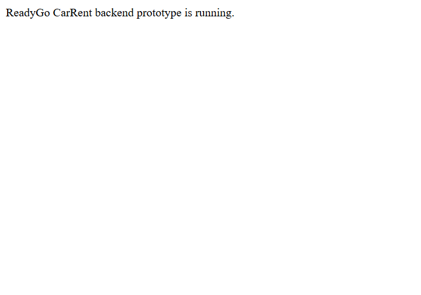
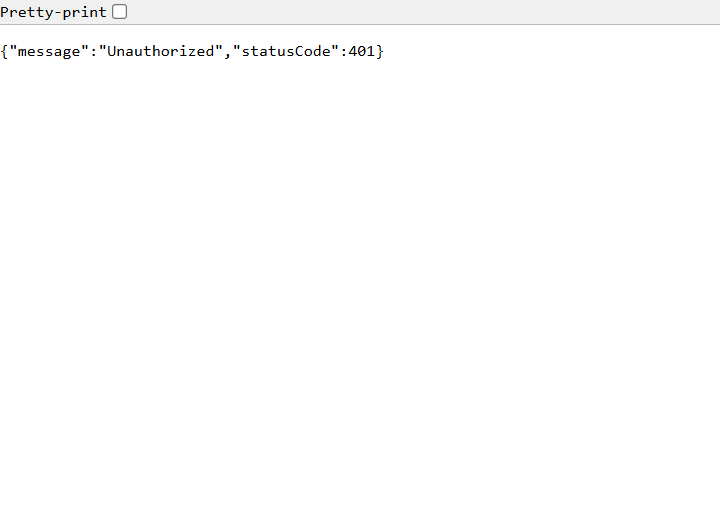

# ReadyGo Backend Implementation

This guide documents the backend that is implemented in this repository. It covers the actual NestJS modules, request handlers, services, TypeORM entities, database setup, authentication, and a live local run.

## Backend directory structure

```text
src/
  main.ts
  app.module.ts
  app.controller.ts
  app.service.ts
  admins/
    admin.entity.ts
    admins.module.ts
    admins.controller.ts
    admins.service.ts
    dto/create-admin.dto.ts
  auth/
    auth.module.ts
    auth.controller.ts
    auth.service.ts
    dto/
      login.dto.ts
      register-customer.dto.ts
  cars/
    car.entity.ts
    cars.module.ts
    cars.controller.ts
    cars.service.ts
    dto/create-car.dto.ts
  common/
    decorators/current-user.decorator.ts
    guards/jwt-auth.guard.ts
    strategies/jwt.strategy.ts
  config/
    jwt.config.ts
    typeorm.config.ts
  customers/
    customer.entity.ts
    customers.module.ts
    customers.controller.ts
    customers.service.ts
    dto/create-customer.dto.ts
  payments/
    payment.entity.ts
    payments.module.ts
    payments.controller.ts
    payments.service.ts
    dto/
      create-payment.dto.ts
      create-simulated-payment.dto.ts
  rental-records/
    rental-record.entity.ts
    rental-records.module.ts
    rental-records.controller.ts
    rental-records.service.ts
    dto/create-rental-record.dto.ts
  reservations/
    reservation.entity.ts
    reservations.module.ts
    reservations.controller.ts
    reservations.service.ts
    dto/create-reservation.dto.ts
```

The application composition is in [`src/app.module.ts`](../src/app.module.ts), and the HTTP bootstrap is in [`src/main.ts`](../src/main.ts).

## NestJS modules implemented

`AppModule` registers configuration, the TypeORM connection, local car-photo storage, and these feature modules:

| Module | Responsibility |
| --- | --- |
| `AuthModule` | Customer registration, login, JWT issuance, and Passport JWT strategy. |
| `AdminsModule` | Admin entity CRUD endpoints and persistence. |
| `CustomersModule` | Customer CRUD endpoints and persistence. |
| `CarsModule` | Car CRUD, image upload, and image serving. |
| `ReservationsModule` | Reservation CRUD and customer-specific reservation history. |
| `PaymentsModule` | Payment records and customer payment simulation. |
| `RentalRecordsModule` | Rental record CRUD associated with reservations. |

Feature modules follow the same Nest pattern: register their repositories with `TypeOrmModule.forFeature(...)`, list a controller, and provide a service. For example, [`CarsModule`](../src/cars/cars.module.ts) registers `Car`, then wires `CarsController` to `CarsService`.

## Controller and service implementation examples

Controllers map HTTP routes to service methods. The car controller uses a DTO for input instead of performing database operations itself:

```ts
@Controller('cars')
export class CarsController {
  constructor(private readonly carsService: CarsService) {}

  @Get()
  findAll() {
    return this.carsService.findAll();
  }

  @Post()
  create(@Body() dto: CreateCarDto) {
    return this.carsService.create(dto);
  }
}
```

This is excerpted from [`src/cars/cars.controller.ts`](../src/cars/cars.controller.ts). The global validation pipe checks DTOs before controller methods run.

The service owns the database operation and its not-found behavior:

```ts
async findOne(id: number) {
  const car = await this.carRepository.findOne({ where: { id } });
  if (!car) {
    throw new NotFoundException(`Car ${id} not found`);
  }
  return car;
}
```

This method is from [`src/cars/cars.service.ts`](../src/cars/cars.service.ts). `CarsService` receives a TypeORM `Repository<Car>` through `@InjectRepository(Car)`. The reservation service demonstrates a multi-entity operation: it loads the customer and car referenced by the DTO, reports missing records, then saves a reservation with those relations in [`src/reservations/reservations.service.ts`](../src/reservations/reservations.service.ts).

## TypeORM entities and relationships

The entities define the persisted tables and their relations. A car has a unique plate number, pricing and status fields, and a one-to-many relationship to reservations:

```ts
@Entity('cars')
export class Car {
  @PrimaryGeneratedColumn()
  id: number;

  @Column({ type: 'varchar', length: 100 })
  brand: string;

  @Column({ type: 'varchar', length: 50, unique: true })
  plateNumber: string;

  @Column({ type: 'decimal', precision: 10, scale: 2, default: 0 })
  dailyRate: number;

  @OneToMany('Reservation', (reservation: Reservation) => reservation.car)
  reservations: Reservation[];
}
```

Excerpted from [`src/cars/car.entity.ts`](../src/cars/car.entity.ts); the complete entity also stores model, year, status, mileage, image URL, and timestamps.

Reservations reference both a customer and a car, and can have an associated rental record:

```ts
@ManyToOne('Customer', (customer: Customer) => customer.reservations, {
  nullable: false,
  onDelete: 'CASCADE',
})
customer: Customer;

@ManyToOne('Car', (car: Car) => car.reservations, {
  nullable: false,
  onDelete: 'CASCADE',
})
car: Car;

@Column({ type: 'date' })
startDate: string;

@OneToOne('RentalRecord', (record: RentalRecord) => record.reservation, {
  nullable: true,
  cascade: true,
})
rentalRecord?: RentalRecord;
```

Excerpted from [`src/reservations/reservation.entity.ts`](../src/reservations/reservation.entity.ts). The other entities are `Admin`, `Customer`, `Payment`, and `RentalRecord`; for example, customer email is unique and the stored password field is `passwordHash`, not plaintext.

## Database connection configuration

The connection is registered by `TypeOrmModule.forRoot(typeOrmConfig())` in `AppModule`. [`src/config/typeorm.config.ts`](../src/config/typeorm.config.ts) selects SQLite by default and supports MySQL when `DB_TYPE=mysql`:

```ts
const dbType = (process.env.DB_TYPE ?? 'sqlite').toLowerCase();

const baseConfig: TypeOrmModuleOptions = {
  type: dbType === 'mysql' ? 'mysql' : 'better-sqlite3',
  entities: [Admin, Customer, Car, Reservation, Payment, RentalRecord],
  synchronize: process.env.NODE_ENV !== 'production',
  logging: process.env.NODE_ENV !== 'production',
};
```

For local SQLite, the database path comes from `DB_NAME` and defaults to `readygo.sqlite`. MySQL reads `DB_HOST`, `DB_PORT`, `DB_USERNAME`, `DB_PASSWORD`, and `DB_NAME` from the environment. No database credentials are included here; configure them in a local `.env` or deployment secret store. Schema synchronization and SQL logging are enabled outside production; use a migration-based schema workflow before production deployment.

## Authentication implementation

`AuthController` exposes:

- `POST /api/carrent/v1/auth/register` - validates a `RegisterCustomerDto`, hashes the password with bcrypt, creates the customer, and returns an access token.
- `POST /api/carrent/v1/auth/login` - checks the customer or admin password hash and issues a JWT.
- `GET /api/carrent/v1/auth/profile` - protected by `JwtAuthGuard`.

`AuthService` handles the repository lookups and token creation in [`src/auth/auth.service.ts`](../src/auth/auth.service.ts). The JWT payload contains the subject ID, email, and role. [`JwtStrategy`](../src/common/strategies/jwt.strategy.ts) extracts a bearer token, validates it, and supplies the payload as the request user. [`CurrentUser`](../src/common/decorators/current-user.decorator.ts) exposes that user to controller methods.

`JWT_SECRET` is required at startup; it is read through [`getJwtSecret`](../src/config/jwt.config.ts). Set a long, random value in the local `.env`; do not commit that file. Token expiry defaults to one day and can be changed with `JWT_EXPIRES_IN`.

The guard is also used by `GET /reservations/mine` and `POST /payments/simulate`. Most admin, customer, car, reservation, payment, and rental CRUD routes are **not** protected by role-based authorization yet. This is a prototype and should not be exposed as a production service until those routes have appropriate authorization.

## How a request moves through ReadyGo

1. [`main.ts`](../src/main.ts) starts the Nest application, sets the `/api/carrent/v1` prefix, enables CORS, and installs the global `ValidationPipe` (`whitelist`, `forbidNonWhitelisted`, and `transform`).
2. Nest matches the prefixed URL and HTTP method to a controller route, such as `POST /api/carrent/v1/cars`.
3. The global pipe validates and transforms the request body using the route's DTO, such as `CreateCarDto`.
4. The controller delegates to its feature service. It does not construct SQL directly.
5. The service uses injected TypeORM repositories to find, create, update, or delete entities. Nest exceptions such as `NotFoundException` become HTTP error responses.
6. Nest serializes the service result as the HTTP response. For guarded routes, Passport first validates the bearer JWT; the validated user is available through `@CurrentUser()`.

Non-API browser requests are served from `public/`; API requests remain under `/api/carrent/v1`.

## Running backend screenshots

These screenshots were captured from the local development server at `http://localhost:3000`:

**Health endpoint** - `GET /api/carrent/v1` returns the backend status response.



**Protected profile endpoint** - `GET /api/carrent/v1/auth/profile` without a bearer token returns HTTP 401, demonstrating the JWT guard.


